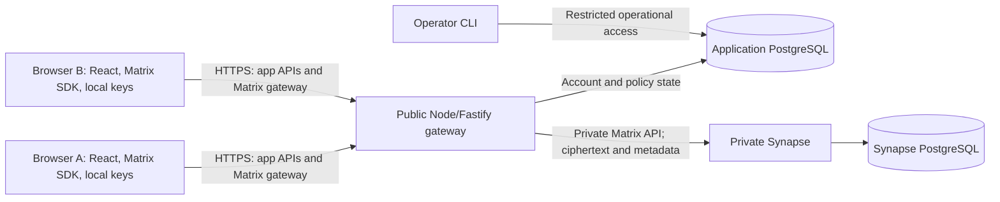

# Encrypted chat MVP: system design

Date: 3 November 2026. Design version: `chat-design-v0.1`.

Status: proposed implementation design for agreed product requirements. No application has been implemented or evaluated by this document. This document is sufficient to start the bounded investigations below; it is not a claim of production readiness.

Companion records: [claims and acceptance criteria](specification.yaml), [initial review and evidence gaps](evidence/2026-11-03-design-review.md), and [evaluation guidance](../../evaluation-pattern.yaml). The claim registry is the source of expected outcomes; evidence records hold actual results. Research context remains in [the project research review](../research-review.md).

## 1. Intent, decisions, and boundaries

Build a responsive browser app in which people publicly register a username, request contact with another person, and exchange private text messages after acceptance. The first evaluation covers 100 registered users and 20 connected users. Success means users can complete that workflow, recover from ordinary connection failures without duplicate messages, and preserve the privacy and authorization requirements in the claim registry.

### Decision provenance

These source IDs are also recorded in the claim registry. Confirmation establishes intended behavior, not evidence of implementation correctness.

| Source | Confirmed in the conversation | Classification |
| --- | --- | --- |
| U-01 | People messaging; working MVP; public signup; private one-to-one conversations; responsive web | Outcomes and product boundaries |
| U-02 | Device-bound sign-in credentials; E2EE; one browser profile per account; no account or message recovery; compatibility restrictions accepted | Privacy and compatibility constraints |
| U-03 | Exact-username discovery; contact requests before messaging; initially unverified chat with optional verification; reports with user-selected evidence | Outcomes and access rules |
| U-04 | Reuse Matrix; prefer simple managed hosting; evaluate a pilot of 100 registered and 20 concurrent users | Implementation choice, preference, and workload |
| P-01 | User subsequently supplied the implementation plan, including React/Vite, Fastify, PostgreSQL, gateway enforcement, blocking, operator tooling, deployment configuration, and evaluation checks | Accepted plan direction; engineering choices remain replaceable |
| D-01 | Details introduced in this design, including API contracts, state transitions, timeout defaults, and investigation gates | Proposed engineering decisions, not independently confirmed business rules |

The proposed p95 delivery target of two seconds comes from P-01. It remains a pilot evaluation target, not a measured result or a production availability commitment. No hosting budget, service-level agreement, or data-retention policy was established.

Excluded from the MVP: groups, attachments, AI, presence, typing indicators, read receipts, push notifications, federation, device linking, identity replacement, recovery, and encryption-key backup. Do not build a general evaluation engine or change the guidance YAML to encode this application's implementation.

### Privacy boundary

- Normal message bodies and message-encryption private keys are unavailable to the gateway, Synapse, databases, operators, and telemetry under the supported client workflow.
- Usernames, account identifiers, room membership, device public keys, timestamps, IP addresses seen by infrastructure, ciphertext sizes, and delivery activity are not promised to be anonymous or hidden.
- Reports are a deliberate disclosure: only the text selected and previewed by the reporter may leave the browser in plaintext for that purpose. A report is an allegation, not independently authenticated proof that another person wrote the submitted text.
- A WebAuthn credential protects authentication; it does not encrypt messages. Matrix private keys live in browser storage and are not promised to be hardware-bound. Device-bound authentication follows the authenticator's backup-eligibility declaration, not a separate hardware-attestation guarantee.
- Compromised endpoints, browser extensions reading the page, maliciously replaced frontend code, recipients copying messages, and manually cloned browser profiles are outside the MVP assurance boundary. Optional contact verification means an initial unverified contact has weaker identity assurance.
- Session tokens are secrets carried over HTTPS. The requirement is that private signing and message keys never leave their intended client storage; it is not a claim that authentication sends no sensitive values at all.

## 2. Architecture and responsibility

| Component | Owns | Must not own |
| --- | --- | --- |
| React/Vite browser app | Account flows, requests, conversations, local outbox, reporting preview, accessibility | Authority to grant access merely by changing UI state |
| Matrix browser adapter | Encryption/decryption, synchronization, history, device trust, protocol retries | New cryptographic protocols or silent replacement of missing device keys |
| Fastify gateway | WebAuthn, sessions, account state, contact/block authorization, controlled Matrix access, report submission | Ordinary plaintext messages or client private keys |
| Private Synapse | Matrix device public keys, encrypted room events, event ordering, protocol synchronization | A publicly reachable route bypassing application policy |
| Application PostgreSQL | Accounts, credentials, sessions, relationships, room mapping, reports, provisioning state | Ordinary plaintext chat history |
| Synapse PostgreSQL | Synapse-managed protocol data | Application-owned copies of Synapse internal schema |
| Operator CLI | Report review, account suspension, audited operational decisions | Arbitrary message decryption |

Use the existing Matrix protocol rather than implement cryptography. The [Matrix JavaScript SDK documentation](https://matrix-org.github.io/matrix-js-sdk/) describes Rust/WASM encryption and a persistent IndexedDB crypto store, and warns against multiple SDK instances sharing it. Initialize crypto before chat becomes available. Acquire a Web Lock before opening the store; another tab displays an “already open” state. Release the lock after stopping the SDK. Unsupported lock or storage capabilities fail clearly rather than opening an unsafe second instance.

### Gateway as the policy boundary

Synapse is reachable only on the private network. Disable federation listeners and outbound federation, public/guest signup, password authentication, and alternative login paths. Do not expose its administration API, media API, recovery endpoints, or arbitrary client API pass-through.

The browser uses an opaque, revocable gateway bearer token as the SDK access token. The gateway maps it to a server-held Synapse token and rewrites upstream authorization. The real Synapse token and JWT login assertion are never returned to the browser. The SDK supports configurable client transport; exercising this adapter is investigation I-02, not an established integration result. See the [SDK client options](https://matrix-org.github.io/matrix-js-sdk/interfaces/matrix.IMatrixClientCreateOpts.html).

For every request, validate the gateway session and account status, normalize and match a known route, and reject unknown routes and versions. Room operations require the authenticated account to match one of the two participants in the application mapping. Writes also require an active relationship with no block in either direction. Never trust client-supplied sender IDs, room IDs, device IDs, or membership assertions without checking the mapping.

| Matrix operation family | Proposed gateway policy |
| --- | --- |
| Version discovery, authenticated identity | Expose only what the pinned SDK requires; report the authenticated mapping |
| Sync, room events, history, state reads | Allow only supported SDK operations; Synapse membership plus application room mapping controls room access; omit unused presence and receipt features |
| Encrypted room-event sends | Only `m.room.encrypted`, mapped room, active participant pair, bounded envelope, stable transaction ID |
| Device-key upload | Only the account's fixed Matrix device; pin initial identity keys and reject replacement; allow valid one-time-key replenishment |
| Key query/claim | Self and accepted contacts' fixed devices only; no wildcard user enumeration |
| To-device messages | Only necessary encryption/verification event types and explicit authorized device destinations; reject wildcard destinations and blocked/unaccepted peers |
| Signature upload and verification support | Own identity signatures and narrowly scoped peer verification required by the SDK; validate targets |
| Room creation, membership, account data | Application-controlled provisioning or specifically allowed own SDK data; no general room, membership, or secret-storage writes |
| Login, registration, extra devices, backups, media, unrelated APIs | Deny to public clients |

I-02 must produce the exact method/path/body allowlist for the pinned SDK and demonstrate that filtered sync and to-device behavior still supports encryption and verification. The table is an intended boundary, not an executable firewall. Encrypted to-device payloads are opaque: authorize their destination and envelope without claiming to inspect their inner content.

## 3. Data and interface contracts

### State ownership

| Entity | Minimum properties and consistency |
| --- | --- |
| Account | Immutable account ID and Matrix user ID; unique canonical username; provisioning/active/suspended status; exactly one credential and one device binding |
| Credential | Credential ID, public key, user handle, signature counter, backup flags, transports; never an authenticator private key |
| Auth challenge | Random challenge, purpose, account or proposed username, browser challenge-session binding, expiry, consumed state; one successful consumption |
| Session | Hashes of opaque session identifiers, account, expiry, revocation; upstream token encrypted with a deployment-held wrapping key |
| Contact pair | Canonically sorted account pair; requester; pending/accepted/rejected state; version; timestamps; unique pair |
| Block | Blocking account and blocked account; unique direction; effective pair policy is blocked if either direction exists |
| Conversation | Unique contact-pair mapping to one canonical room; provisioning/ready/failed state; private two-person room; recoverable provisioning operation ID |
| Device binding | Fixed Matrix device ID and initial public identity fingerprints; cannot be overwritten through login or reinitialization |
| Report | Reporter, reported participant, conversation, reason, explicit selected-text snapshot, timestamps, review status; access limited to operators |
| Audit entry | Actor, action, target identifiers, time, result; no message bodies, selected report text, credentials, or bearer tokens |

Use application and Synapse databases with separate roles. Do not update Synapse tables directly. Browser IndexedDB holds SDK crypto state, pinned trust information, and an account-scoped outbox. Locally queued plaintext is confined to that browser; only an encrypted envelope may enter the message transport.

Usernames default to lowercase ASCII letters, digits, and underscores, 3–32 characters, with exact normalized lookup and a database uniqueness constraint. This is D-01, not a user-confirmed naming requirement. Account and room IDs remain opaque to application clients. Never reassign an abandoned username as a recovery mechanism.

### Application APIs

All routes are same-origin HTTPS outside localhost development. Require schema validation and bounded bodies. Cookie-authenticated mutations require CSRF protection and an exact allowed origin. Authentication failures do not disclose credential details. IDs and display values are escaped when rendered.

| Route | Input and observable result |
| --- | --- |
| `POST /api/auth/register/options` | Username and acknowledgement of no recovery; returns WebAuthn options and a challenge reference; does not activate an account |
| `POST /api/auth/register/verify` | Challenge reference and registration response; validates credential, begins idempotent provisioning, and creates a session only after authentication succeeds |
| `POST /api/auth/login/options` | Username; returns a challenge bound to the known credential flow |
| `POST /api/auth/login/verify` | Challenge reference and assertion; returns session state using the existing account and device binding |
| `GET /api/session` | Returns account, fixed Matrix identifiers, provisioning state, and an expiring gateway token; no upstream credentials or encryption secrets |
| `POST /api/auth/logout` | Revokes the session and gateway token; preserves local crypto state for later sign-in |
| `GET /api/users?username=...` | Authenticated exact lookup; minimal account identity; no directory or prefix search |
| `GET /api/contacts` | Incoming/outgoing request state, accepted contacts, and accessible conversation mappings |
| `POST /api/contact-requests` | Target account ID; idempotently creates or returns a pending request; cannot accept on the target's behalf |
| `POST /api/contact-requests/:id/accept` | Recipient only; accepts once and starts/reuses conversation provisioning; returns `202` while provisioning |
| `POST /api/contact-requests/:id/reject` | Recipient only; terminates the pending request; does not create a room |
| `PUT /api/blocks/:accountId` | Creates the caller's block, cancels pending requests, and prevents future pair writes |
| `DELETE /api/blocks/:accountId` | Removes only the caller's block; another participant's block still applies |
| `POST /api/reports` | Client-generated report ID, participant/room IDs, reason, and explicitly previewed selected text; persists once and acknowledges the same ID on retry |

Application errors have a stable code and request ID without echoed private input: `400` malformed input, `401` invalid session, `403` forbidden action, `404` inaccessible resource, `409` conflicting state, `429` throttled request, `503` dependency unavailable. Matrix routes retain Matrix response shapes so the SDK can handle them. Rate-limit signup, login, lookup, contact requests, reports, and message envelopes; tune operational limits from measurements and record them in evidence.

## 4. Workflows and failure behavior

### Registration and subsequent sign-in

1. Display the compatibility restriction and explain that losing the authenticator or browser crypto data can permanently remove access. Capture acknowledgement before creating registration options.
2. Generate a fresh challenge with a proposed five-minute expiry. Bind it to the challenge session, purpose, and username reservation. Verify with SimpleWebAuthn; require user verification, correct origin/RP ID, and backup eligibility `BE=0`. Check backup state consistency and enforce the policy again on authentication. These flags describe credential backup eligibility in the [WebAuthn standard](https://www.w3.org/TR/webauthn-3/); `BE=0` alone does not certify hardware quality.
3. Atomically consume the challenge and create the unique account/credential record. Expired, replayed, substituted, or competing responses fail. Use library counter validation; an authenticator returning zero counters does not by itself establish a cloned credential.
4. Assign one stable Matrix user/device mapping. The gateway signs a short-lived, audience- and issuer-bound JWT and exchanges it with private Synapse. [Synapse documents its JWT login type](https://element-hq.github.io/synapse/latest/jwt.html); the actual account-provisioning and repeated-device behavior must be established in I-01.
5. The browser acquires the store lock and initializes the crypto store once. Pin its initial device identity keys at the gateway. Finish device setup before accepting contacts or sending messages.
6. On return, require the existing store and binding. Resume the same Matrix device and reauthenticate with the fixed WebAuthn credential. Missing or mismatched keys show a terminal local-data-loss state; do not upload a new identity under the old device ID. A movable hardware authenticator does not make a new browser a supported messaging device.

Use Secure, HttpOnly, SameSite=Strict cookies in production; default sessions expire after 24 hours without silent indefinite renewal. Expiry requires WebAuthn again. Revocation or suspension invalidates gateway bearer tokens immediately for new operations. Ordinary logout does not erase local crypto storage; the UI explains that distinction. Persistent store failure prevents signup from being advertised as complete.

### Contact acceptance and room provisioning

Store the relationship in the application database before creating a Matrix room. Only the recipient can accept; crossed requests stay pending until one recipient explicitly accepts. Serialize changes by canonical account pair, so repeat acceptance produces one canonical conversation.

After acceptance, a durable provisioning operation creates a private, non-federated, encrypted room using one participant's server-held upstream identity. Set history visibility to joined members, allow the intended peer, and prevent later extra invitations or configuration changes through the public gateway. The peer's authenticated join is allowed only for this mapping. Messaging remains unavailable until both intended members and room encryption are confirmed.

The database and Synapse cannot share one transaction. Persist a provisioning operation ID and room marker, retry against recorded progress, and reconcile an uncertain creation response before another creation attempt. Orphan rooms are never returned as conversations. I-03 must establish a reliable reconciliation method; if creation cannot be disambiguated, leave the operation pending for operator investigation rather than produce duplicate active rooms.

### Sending, reconnect, and history

The browser writes a stable transaction ID and local pending record before sending. It checks room readiness and identity trust, encrypts using the SDK, and sends the encrypted event through the gateway. A send response marks the event accepted by the service; it does not mean delivered or read. The recipient decrypts after sync. History pagination deduplicates on event ID.

The [Matrix transaction-ID contract](https://spec.matrix.org/latest/client-server-api/#transaction-identifiers) supports idempotent retransmission within its defined device and endpoint scope. Retain that scope, transaction ID, and encrypted payload across lost responses, token changes, refreshes, and reconnects; I-03 must test the actual SDK lifecycle rather than infer exactly-once delivery from the presence of an ID.

Use sending/accepted/failed states and a separate connection indicator. A disconnect keeps pending work local, with bounded backoff; a permanent policy error requires user action. On restart, reconcile pending transactions before retrying. Never silently discard a failed message or retry it under a new ID. Pending messages are rechecked against current block, suspension, and trust state before transmission.

### Verification, blocking, and reporting

Initially show unverified identity explicitly. Offer the SDK's short-authentication-string verification workflow and explain that participants compare it using an independently trusted channel. Store verified identity fingerprints locally. Cancellation or mismatch does not mark a device verified. Previously verified identity changes stop sending; because replacement is unsupported, no “trust replacement and continue” shortcut is included. I-04 verifies compatibility with the no-backup, single-device policy.

Blocking and message authorization share a per-pair serialization boundary at the gateway. A block response is returned after earlier authorized sends have completed or been classified as indeterminate. Requests authorized before the block may already be accepted upstream or arrive later; a block cannot retract messages or keys already delivered. No send authorized after the block's effective point may reach Synapse. Existing history remains readable to its original participants. Unblocking never auto-sends the outbox and never restores a cancelled pending request.

Reports contain only text the reporter deliberately selects, a reason, and relevant identifiers. Show the exact payload in a confirmation preview. Do not automatically attach surrounding history, keys, or SDK diagnostic dumps. Treat report text as untrusted input. The operator CLI lists report metadata, reveals selected evidence only on an explicit review action, records a disposition, and can suspend the reported account and revoke sessions. Do not put report bodies into routine logs.

## 5. Deployment and operations

Provide Docker Compose with the gateway, private Synapse, and separate logical application/Synapse databases. Expose only the gateway; use localhost's permitted WebAuthn development origin or local HTTPS. Keep development RP IDs, users, and server names separate from deployment identities.

The proposed managed deployment is a Render public web service serving the built SPA and gateway, a Synapse private service, and managed PostgreSQL. [Render private services](https://render.com/docs/private-services) supply the intended network boundary, but deployment verification must prove no alternative public path reaches Synapse or the databases. Use persistent storage for Synapse-required state, managed secrets, separate database roles, and backups of server data. Server backups cannot restore missing browser keys.

Choose a stable HTTPS origin, WebAuthn RP ID, and Matrix server name before registering pilot users. No domain has been selected. Pin compatible runtime, SDK, and container versions during I-01 and record them; this document does not invent tested versions. Apply reviewed forward database migrations before traffic. Roll back application images only when compatible with the current schema. Preserve Synapse signing material across restarts.

Operational measurements include service/dependency health, request counts, status codes, request duration, rejected policy operations, provisioning age/failure, and aggregate queue depth. Do not label metrics with usernames, room IDs, message bodies, report evidence, or tokens. Any browser delivery-timing telemetry uses synthetic test IDs or aggregate values without text. Keep SDK debug logging disabled in normal use and audit infrastructure request-body capture.

Initial alerts flag unavailable dependencies, persistent provisioning failures, repeated authorization errors, and failed synthetic encrypted delivery. Thresholds, hosting cost, capacity, retention/deletion schedules, incident staffing, and backup restoration timing remain open pilot-launch decisions. Before public signup is enabled, resolve retention for ciphertext, metadata, reports, logs, and backups and publish the corresponding notice. No automatic expiry or indefinite-retention promise is implied by this design.

## 6. Evaluation and next decisions

The YAML's areas are not mandatory sequential phases. The increments below bound the next decisions; a finding can send work back to specification or design. An acceptance-criteria change needs its own rationale and confirmation, separate from repairing code to pass an existing check.

| Investigation | Bounded question and deliverable | Blocks |
| --- | --- | --- |
| I-01 | Pin versions; register two device-bound credentials; exchange JWTs; preserve one device through logout/relogin; refresh and decrypt; reject missing stores and replacement identity keys. Record hardware/browser combinations and restart behavior. | Choosing the authentication/crypto integration for implementation |
| I-02 | Implement the gateway adapter against private Synapse; enumerate SDK routes; exercise sync, key replenishment, verification, and third-party/membership/to-device bypass attempts. Prove unsupported routes fail closed. | Accepting the gateway policy design |
| I-03 | Inject failures between application commits and room creation; duplicate acceptance; drop send responses; restart browsers/gateway; race sends against blocks. Record canonical-room reconciliation and event counts. | Accepting workflow correctness |
| I-04 | Verify two contacts without cloud secret/key backup; test mismatch/cancellation and changed trusted identity; inspect all network payloads, stores, and logs with canary text, excluding only explicitly selected report disclosures. | Accepting the identity/privacy claims |
| I-05 | Evaluate responsive and keyboard flows, operator reporting/suspension, deployment isolation, and the pilot workload; document costs and unresolved launch policy. | Declaring pilot readiness |

Use actual browser contexts and the real SDK/Synapse path for end-to-end checks. Virtual authenticators can cover negative WebAuthn cases; separate real-device checks are needed for compatibility claims. Unit tests or mocks alone cannot satisfy encrypted workflow claims.

For the pilot measurement, seed 100 accounts, connect 20 users in ten accepted pairs, warm the system, and send one aggregate text message per second for ten measured minutes with bodies at most 4 KiB. Measure send invocation to recipient decryption using a common test-runner clock, report p50/p95/max, errors, missing deliveries, resource use, and queue behavior. Do not remove undelivered events to improve the percentile; report them as failures and include retry/reconnect scenarios separately. These workload details are D-01 defaults; the two-second target is proposed, not evidence.

### Applying the core loop

1. Select claim IDs, applicable conditions, and the next decision.
2. Run the linked check or perform a bounded design analysis.
3. Record observed results, versions, workload, limitations, and counterexamples in a new evidence record.
4. Decide to accept within the evidenced scope, reject, investigate, or obtain more evidence. Unknown claims remain unknown.
5. Revise the implicated specification, design, implementation, model, or assumption and re-evaluate affected claims.

The claim registry uses `unverified` for an unknown satisfaction status. This is distinct from whether the requirement itself is confirmed. Initial evidence supports only document/repository observations and source-level feasibility; it does not establish any running-app claim. Revisit evidence after relevant dependency, code, origin, workload, or requirement changes.

The immediate decision is to begin I-01/I-02, not release the service. A failed experiment may require changing the proposed integration, but cannot silently weaken E2EE, device-bound authentication, or authorization requirements.
